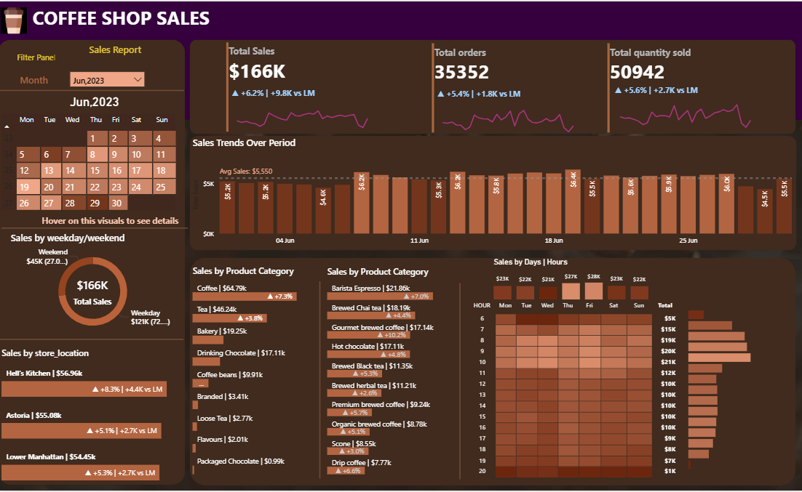
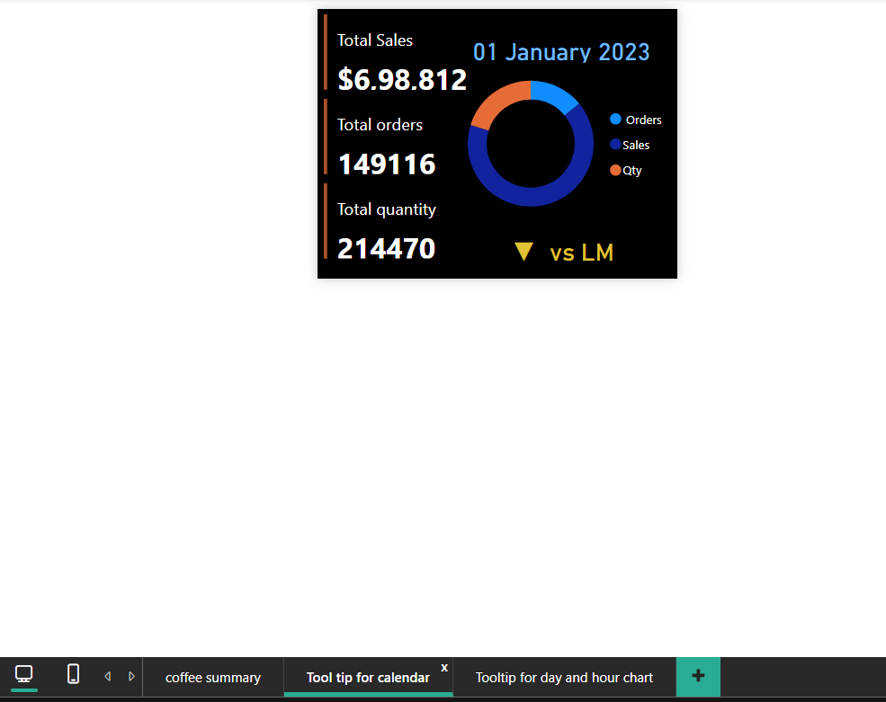
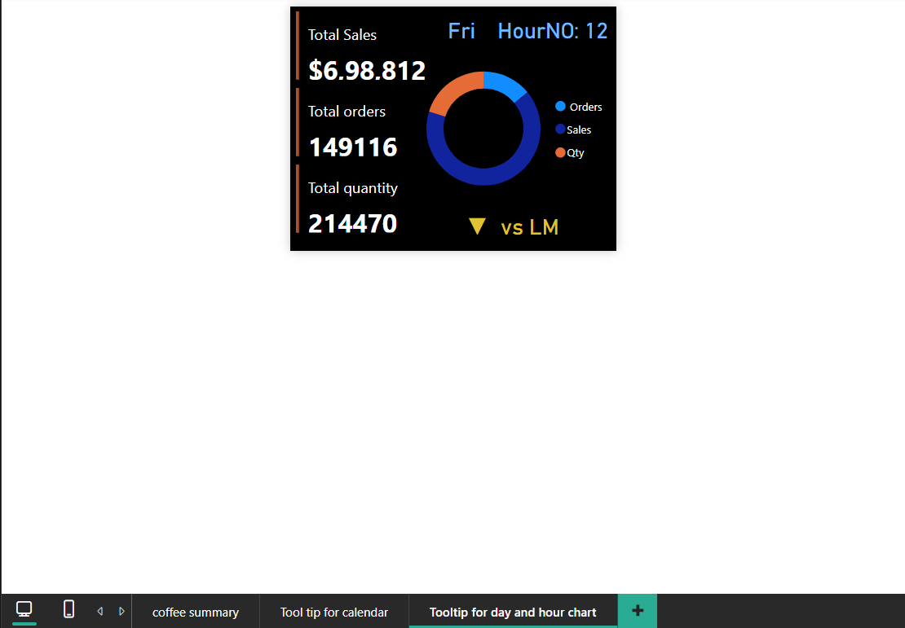

# Coffee Shop Sales Analysis | SQL, Excel, Power BI

An end-to-end analysis of **149,116 transactions** from a 3-store coffee shop chain (Jan–Jun 2023). SQL and Excel were used to prepare and analyse the data, and an interactive Power BI report shows sales, orders and quantity trends by time, store and product.



## Business problem
Store managers need to know *when* sales peak, *which* stores and products drive revenue, and *how* each month compares with the last, so they can plan staffing and stock. This report answers those questions in one view.

## Dataset
| Item | Detail |
|---|---|
| Transactions | 149,116 (1 Jan – 30 Jun 2023) |
| Stores | 3 (Astoria, Hell's Kitchen, Lower Manhattan) |
| Products | 80 products, 29 product types, 9 categories |
| Fields | date, time, quantity, store, product, category, unit price |
| File | [`data/coffee_shop_sales.xlsx`](data/coffee_shop_sales.xlsx) |

## Key results
| Metric | Value |
|---|---|
| Total sales | **$698,812** |
| Units sold | 214,470 |
| Sales growth | **$81.7K (Jan) to $166.5K (Jun), about 2x** |
| Peak hour | **10 AM** |
| Weekend share of sales | 27.9% |
| June 2023 snapshot | $166K sales, 35,352 orders, 50,942 units (+6.2% sales vs May) |

**What the data shows**
- Sales dipped slightly in February ($76.1K) and then rose every month through June.
- **Coffee ($270.0K) and Tea ($196.4K)** together bring in about two-thirds of revenue.
- The three stores perform almost evenly (about $230K–$237K each), led by Hell's Kitchen.
- Weekdays account for roughly 72% of sales, with the busiest hours in the morning.

## What the dashboard includes
- **KPI cards:** total sales, total orders and total quantity sold, each with month-over-month change.
- **Calendar heat map and tooltips:** pick a month and see daily detail on hover.
- **Daily sales vs average:** each day is compared with the monthly average sales line.
- **Weekday vs weekend split.**
- **Sales by store location and by product category / top products.**
- **Sales by day and hour heat map** to show peak trading times.

| Calendar tooltip | Detail tooltip |
|---|---|
|  |  |

## SQL used
Queries for total sales, orders and quantity with month-over-month change, weekday vs weekend sales, sales by store, daily sales vs average (above/below average flag), sales by category, top 10 products and sales by day and hour are documented in [`sql/coffee_shop_sql_queries.pdf`](sql/coffee_shop_sql_queries.pdf).

## Skills demonstrated
- SQL: aggregation, date and time functions, MoM comparisons, CASE logic, ranking
- Excel: data preparation and checks
- Power BI: KPI cards, DAX measures, slicers, heat maps, custom tooltips, conditional formatting
- Turning raw sales data into decisions on staffing, stock and store performance

## Repository structure
```
coffee-shop-sales-analysis/
├── data/          coffee_shop_sales.xlsx
├── dashboard/     coffee_shop_sales.pbix
├── sql/           coffee_shop_sql_queries.pdf
├── screenshots/   dashboard images
└── README.md
```

## How to open the dashboard
Open `dashboard/coffee_shop_sales.pbix` in Power BI Desktop (free to download from Microsoft).

## Contact
**Madhumitha Divate** | madhudivate28@gmail.com | [LinkedIn](ADD-YOUR-LINKEDIN-LINK) | Bengaluru, India
